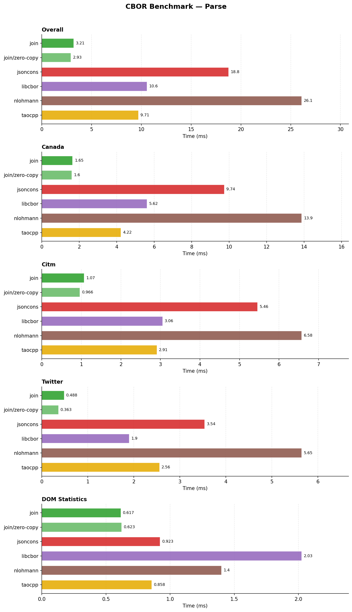
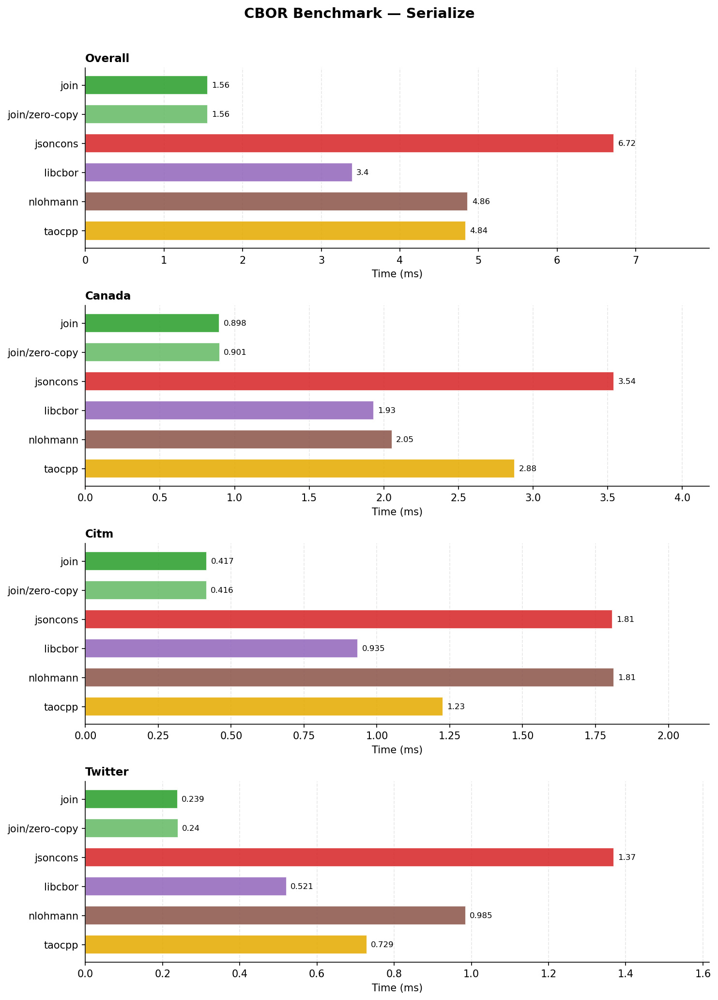
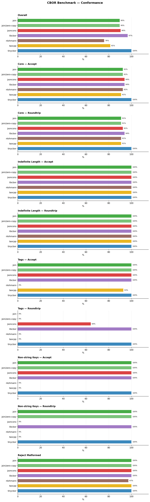

# cbor-benchmark

Comparative benchmarks of CBOR ([RFC 8949](https://www.rfc-editor.org/rfc/rfc8949)) libraries in C and C++, measuring parse, serialize, and DOM statistics performance across three real-world datasets (Canada, CitmCatalog, Twitter). Includes a conformance suite covering format acceptance, indefinite lengths, tags, non-string keys, rejection of malformed input, and value-preserving roundtrip.

Companion of [json-benchmark](https://github.com/joinframework/json-benchmark) and [pack-benchmark](https://github.com/joinframework/pack-benchmark), with the same protocol and layout.

## Table of contents

- [Libraries](#libraries)
- [Datasets](#datasets)
- [Build](#build)
- [Running benchmarks](#running-benchmarks)
- [Plots](#plots)
- [What the benchmarks measure](#what-the-benchmarks-measure)
  - [Parse](#parse)
  - [Serialize](#serialize)
  - [Statistics](#statistics)
  - [Conformance](#conformance)
- [Notes](#notes)
- [Test machine](#test-machine)
- [Results](#results)
  - [Performance](#performance)
  - [Conformance](#conformance-1)
  - [Conclusion](#conclusion)
- [License](#license)

## Libraries

| Library | Version | Parse | Serialize | Statistics | Conformance |
|---------|---------|-------|-----------|------------|-------------|
| [Join](https://github.com/joinframework/join) (default) | `main` (021fd05) | ✓ | ✓ | ✓ | ✓ |
| [Join](https://github.com/joinframework/join) (zero-copy) | `main` (021fd05) | ✓ | ✓ | ✓ | ✓ |
| [jsoncons](https://github.com/danielaparker/jsoncons) | 1.10.0 | ✓ | ✓ | ✓ | ✓ |
| [libcbor](https://github.com/PJK/libcbor) | 0.14.1 | ✓ | ✓ | ✓ | ✓ |
| [nlohmann/json](https://github.com/nlohmann/json) | 3.12.0 | ✓ | ✓ | ✓ | ✓ |
| [taocpp/json](https://github.com/taocpp/json) | 1.0.0-beta.14 | ✓ | ✓ | ✓ | ✓ |
| [TinyCBOR](https://github.com/intel/tinycbor) | 7.1 | — | — | — | ✓ |

All dependencies are fetched automatically via CMake FetchContent, pinned to their latest release (Join is taken from its main branch; taocpp/json uses PEGTL 3.2.9).

Libraries fall into two categories, the zero-copy ones being labelled `/zero-copy` in the plots:
- **copying** — the DOM owns its strings and byte strings, and the input buffer can be released after parse;
- **zero-copy** — the DOM references the input buffer for strings and byte strings, which must outlive the DOM. Parse then does no string copy, and statistics or serialize read the payloads from the input. Their figures are not like-for-like with the copying libraries.

**Join** is benchmarked in two configurations:
- **default** — `CborReader`: strings and byte strings are copied into the DOM's bump allocator;
- **zero-copy** — `BasicCborReader<CborReadMode::ZeroCopy>`: definite-length strings and byte strings reference the input buffer; indefinite-length ones, assembled from their chunks, are copied.

Join skips tags on read (the tagged item is kept, the tag number is dropped) and writes its output with the preferred serialization of RFC 8949 §4.1 (shortest integer and length encodings, a float as `float16` or `float32` when the conversion is exact, definite lengths).

**libcbor** is a C library, built from its sources. Its DOM is a tree of reference-counted `cbor_item_t`, decoded with `cbor_load` and written with `cbor_serialize_alloc` into a `malloc`ed buffer. It keeps the encoding of every item (integer width, float width, definite or indefinite length), tags included.

**nlohmann/json**, **jsoncons** and **taocpp/json** are JSON libraries with a CBOR codec on top of their JSON DOM (`from_cbor`/`to_cbor`, `cbor_bytes_reader`/`encode_cbor`, `cbor::from_string`/`cbor::to_string`). Their object keys are strings: nlohmann/json and taocpp/json reject maps with other keys, jsoncons converts such keys to their text form. nlohmann/json runs with its default tag handler, which rejects every tag (`cbor_tag_handler_t::error`). jsoncons (`jsoncons::json`), nlohmann/json and taocpp/json store objects sorted by key, so their output does not keep the input key order.

**TinyCBOR** is a C library with no DOM: a `CborValue` cursor walks the input in place. It is measured in conformance only, since its parse would be a validation pass, its statistics a second pass over the input and its serialize a re-encoding of the input, none of them comparable with a DOM library. Its adapter validates the document (`cbor_value_validate`, `CborValidateBasic`) and serializes it by walking it with the parser and writing every item with the encoder. libcbor and TinyCBOR export functions with the same names (`cbor_encode_uint`, `cbor_encode_tag`...), so they cannot be linked into one binary: conformance, like performance, runs one binary per library.

Every adapter decodes a whole document: input left over after the first item is rejected. Join, nlohmann/json (`from_cbor` with `strict = true`) and taocpp/json check it natively. jsoncons, libcbor and TinyCBOR decode one item and report the bytes they used (`cbor_bytes_reader::column`, `cbor_load_result::read`, `cbor_value_get_next_byte`); their adapters reject the input when that count is not its size.

Output buffers follow one rule: each library writes into its native output buffer (`std::string` for jsoncons, nlohmann/json and taocpp/json, `malloc`ed block for libcbor). When the adapter has to provide the buffer, as for Join's `std::ostream`, it starts at 8 KiB and doubles when full.

## Datasets

| File | Size | Characteristics |
|------|------|-----------------|
| `canada.cbor` | ~1.1 MB | Geometry data — float-heavy (coordinate pairs), large arrays |
| `citm_catalog.cbor` | ~0.3 MB | Event catalog — deeply nested objects, mixed types |
| `twitter.cbor` | ~0.4 MB | Social feed — Unicode strings, many small objects |

The files are the json-benchmark datasets encoded with the preferred serialization of RFC 8949 §4.1: shortest integer and length encodings, every JSON floating-point number in the shortest of `float16`, `float32` and `float64` that holds it exactly, definite lengths, and the key order of the JSON input. Integers, strings and floats are encoded by the reference Python implementation ([cbor2](https://pypi.org/project/cbor2/)), floats in its `canonical` mode, which shortens them; the script writes the map and array headers itself, since `canonical` would also sort the keys. Each file is checked by decoding it back with cbor2. To regenerate them:

```bash
python3 -m venv .venv
.venv/bin/pip install cbor2
.venv/bin/python -I scripts/gen_data.py ../json-benchmark/data data
```

Each benchmark binary is run several times, each repetition in a new process. The time reported is the minimum across repetitions, and the overall time is the sum over the three datasets (ms), computed per repetition before taking the minimum.

## Build

Configure:

```bash
cmake -B build -DCMAKE_BUILD_TYPE=Release
```

Join is fetched from its `main` branch; to build against a local working tree instead:

```bash
cmake -B build -DCMAKE_BUILD_TYPE=Release -DFETCHCONTENT_SOURCE_DIR_JOIN=/path/to/join
```

Compile:

```bash
cmake --build build -j$(nproc)
```

## Running benchmarks

Run everything and generate plots:

```bash
bash scripts/run_bench.sh
```

Single binary (one per operation and library, `bench_<operation>_<library>`):

```bash
GLIBC_TUNABLES=glibc.malloc.mmap_threshold=33554432:glibc.malloc.trim_threshold=4294967296 \
taskset -c 2 ./build/benchmarks/performance/bench_parse_libcbor \
    --benchmark_format=json \
    --benchmark_out=results/parse_libcbor.json \
    --benchmark_min_warmup_time=0.5
```

Conformance only (one binary per library, `conformance_<library>`; `-v` lists the failed cases):

```bash
./build/benchmarks/conformance/conformance_libcbor --header --output results/conformance_libcbor.json
```

> [!NOTE]
> Default: 3 repetitions per binary (`REPETITIONS`), each in a new process, minimum reported. Override with e.g. `REPETITIONS=5 bash scripts/run_bench.sh`. Raw per-repetition results are written to `results/runs/`.

## Plots

Install plotting dependencies, either from the distribution (Debian/Ubuntu):

```bash
sudo apt install python3-matplotlib python3-pandas
```

or in a virtual environment:

```bash
python3 -m venv .venv
.venv/bin/pip install -r plots/requirements.txt
```

Generate the charts:

```bash
python3 plots/plot.py results/conformance_*.json results/runs/*.json
```

Bars show the minimum across processes.

PNGs are written to `plots/`:
- `performance_parse.png` — parse (overall + per dataset) and DOM statistics
- `performance_serialize.png` — serialize (overall + per dataset)
- `conformance.png` — overall score followed by one subplot per score (accept and roundtrip for core, indefinite length, tags and non-string keys, then reject)

## What the benchmarks measure

### Parse

**Goal**: time to decode a CBOR document into an in-memory DOM.

The benchmark calls `Adapter::parse(cbor)` and measures only the decoding time. DOM destruction is excluded from timing (`PauseTiming` / `ResumeTiming`), as in json-benchmark.

**What is measured**: format decoding, byte-order conversion, and DOM construction.

**What is not measured**: DOM traversal, serialization, input I/O.

---

### Serialize

**Goal**: time to serialize a pre-decoded DOM back to CBOR bytes.

The document is decoded once before the timing loop; each iteration serializes the same DOM into the library's native output buffer.

**What is measured**: DOM traversal and CBOR generation.

Each library picks its own encoding. Join, libcbor and TinyCBOR reproduce the three inputs byte for byte: Join writes the same preferred serialization as the datasets, libcbor and TinyCBOR keep the encoding they read. jsoncons and nlohmann/json write `canada.cbor` 318 bytes longer (1 055 552 instead of 1 055 234) and taocpp/json 966 bytes longer (1 056 200); on `twitter.cbor`, jsoncons, nlohmann/json and taocpp/json produce the same size as the input but differ from it by their sorted key order; all libraries reproduce `citm_catalog.cbor` byte for byte.

---

### Statistics

**Goal**: time to traverse the entire DOM and accumulate counts of each node type (maps, arrays, strings, numbers, booleans, nulls).

The document is decoded once before the timing loop. Each iteration walks every node in the tree. A map key is counted as a value of its own type, so the counts stay comparable with json-benchmark's, where every key is a string.

---

### Conformance

Run once (no timing), on hand-written CBOR byte strings. The 102 valid documents are split into four categories, each scored twice — **accept** (the library decodes it) and **roundtrip** (decode, serialize, and compare the output value by value with the input):

1. **Core** (66 cases): unsigned and negative integers at every width and at their bounds (down to -2^64), non-minimal integer, length and float encodings, `float16`, `float32` and `float64` (including `-0.0`, subnormals, infinities and NaN), `false`, `true`, `null`, `undefined` and unassigned simple values (one-byte and two-byte), text strings (empty, with an embedded NUL, UTF-8, up to 64 KiB), byte strings, empty and nested arrays and maps, and 100 nested arrays.
2. **Indefinite length** (13 cases): chunked text and byte strings (empty, with an empty chunk), indefinite arrays and maps, nested or inside definite containers, and an indefinite text used as a map key.
3. **Tags** (14 cases): standard date and time (0, 1), bignums (2, 3), embedded CBOR (24), URI (32), the self-described CBOR prefix (55799), an unknown tag, a 64-bit tag number, nested tags, and tags in an array, on a map key and on a map value.
4. **Non-string Keys** (9 cases): maps keyed by a positive, negative or `uint64` integer, null, booleans, a float, a byte string, an array, or a map.

**Reject** (38 cases), all of them not well-formed in the sense of RFC 8949 §3 and Appendix F: empty input, reserved additional information 28 to 30, indefinite length on an integer or a tag, a `break` outside an indefinite container or in place of a map value, every argument and float truncated, a two-byte simple value below 32, string and byte string payloads shorter than their header, arrays, maps and tags missing items, headers declaring 4 GiB or more with no data, unterminated indefinite containers and strings, a chunk of the wrong major type or of indefinite length inside an indefinite string, and a trailing byte after a complete document. Well-formed but invalid input (invalid UTF-8, duplicate keys, a tag on the wrong type) is not scored.

The roundtrip is judged by a small CBOR decoder in `conformance/main.cpp`, independent of every library under test. It decodes both documents into the CBOR data model and compares them: integers by value whatever their encoding width, floating-point numbers bitwise as `double` after widening `float16` and `float32`, text and byte strings byte for byte and never with each other, an indefinite string as the concatenation of its chunks, simple values by number (`undefined` is not `null`), tags by number and content, maps key by key regardless of order. A library that drops a tag therefore fails the roundtrip of every tagged case.

In addition, an **output check** guards the performance benchmarks: on each dataset, the DOM statistics of every library must equal the statistics of the reference decoder, re-decoding a library's own serialize output must yield the same statistics, and the output must equal the input value by value (same comparison as the roundtrip). Any mismatch is reported on stderr and makes `conformance_<library>` exit with status 1, which stops `run_bench.sh` before any timing.

## Notes

- `-march=native`: CPU-specific SIMD optimisations. Results are not portable across machines.
- Every binary is compiled as C++17, except those linked against Join (`bench_*_join`, `bench_*_join_zero_copy` and `conformance_join`), compiled as C++20, the standard Join requires.
- Each library is measured in its own binary (`bench_<operation>_<library>`), linked only against that library, and each repetition runs in a new process, interleaved across libraries (see json-benchmark for the measurements behind both choices). The two Join configurations also have their own binaries: in a shared binary, the code layout of one changed the timings of the other.
- The allocator policy is fixed for every library (`GLIBC_TUNABLES`: 32 MB `mmap` threshold, trimming disabled), and `--benchmark_min_warmup_time=0.5` lets the heap reach its steady-state size before measurement. Each benchmark reports its page faults per iteration as the `minflt` counter; `plot.py` warns when it is not zero.
- Benchmarks are pinned with `taskset -c $BENCH_CPU` (default 2). They are single-threaded, so pinning the process pins the measured thread.
- Build and measurement are separated. `run_bench.sh` refuses to measure unless the governor is `performance` and boost is disabled, then waits until the CPU is back to 98% of its rated clock. `ALLOW_NOISY=1` overrides both checks.
- Every compiled library is linked statically, and every library runs with its default allocator.
- Serialize returns each library's output buffer (see the buffer rule under [Libraries](#libraries)) without converting it.
- Result JSONs are gitignored (`results/`); plots are committed under `plots/`.

## Test machine

All figures below come from a single run on this machine (3 repetitions, each in its own process). They are not portable: `-march=native` alone makes them specific to this CPU.

| | |
|---|---|
| CPU | AMD Ryzen 7 2700X, 8 cores / 16 threads (Zen+), 1 socket, 1 NUMA node |
| Frequency | 3700 MHz, `performance` governor, boost disabled |
| Caches | L1d 8 × 32 KiB, L2 8 × 512 KiB, L3 2 × 8 MiB |
| RAM | 16 GiB |
| OS | Ubuntu 26.04.1 LTS, kernel 7.0.0-43-generic |
| Toolchain | GCC 15.2.0, CMake 4.2.3 |
| Compile flags | `-O3 -DNDEBUG -march=native -std=c++17` (`-std=c++20` for Join, which requires it) |
| Join | `main` at `021fd05` (2026-11-15), with the zero-copy read mode applied from a local working tree |
| Pinning | `taskset -c 2` (physical core, SMT sibling 10) |
| Conditions | idle machine, 3 repetitions, run started once the CPU was back to its rated clock (3689 MHz); no page fault in steady state except nlohmann/json serialize on `canada.cbor` (0.003 per iteration); spread across repetitions below 2% for 48 of 54 benchmarks and below 5% for 53; the outlier is Join statistics on `citm_catalog.cbor` (11%) |

## Results

Measured on the machine above. Re-run `scripts/run_bench.sh` to reproduce on other hardware; results are not portable across machines (`-march=native`).

### Performance





**Parse**: **Join** zero-copy leads at 2.93 ms, followed by **Join** default (3.21 ms): both take about 1.6 ms on `canada.cbor`, which holds almost no strings, and differ on `twitter.cbor` (0.36 against 0.49 ms), where the default configuration copies every string into its allocator. **taocpp/json** (9.71 ms) and **libcbor** (10.6 ms) follow, about 3× behind; libcbor is the slower of the two on the float-heavy `canada.cbor` (5.62 against 4.22 ms) and the faster on `twitter.cbor` (1.90 against 2.56 ms). **jsoncons** (18.8 ms) and **nlohmann/json** (26.1 ms) are the slowest, 6 to 9× Join.

**Serialize**: both **Join** configurations lead at 1.56 ms, ahead of **libcbor** (3.40 ms), which writes the encoding it kept for every item. **taocpp/json** (4.84 ms) and **nlohmann/json** (4.87 ms) follow, and **jsoncons** (6.72 ms) is the slowest.

**Statistics**: **Join** leads at 0.62 ms in both configurations, followed by **taocpp/json** (0.86 ms) and **jsoncons** (0.92 ms), then **nlohmann/json** (1.40 ms). **libcbor** (2.03 ms) is the slowest: every item is a separately allocated, reference-counted `cbor_item_t`, reached through a function call per access.

### Conformance



**Core**: only **TinyCBOR** accepts and roundtrips all 66 cases. Every other library rejects the unassigned simple values (`simple(0)`, `simple(19)`, `simple(32)`, `simple(255)`). -2^64, the smallest negative integer, is rejected by **Join** and **taocpp/json**, and accepted but not written back by **jsoncons** and **nlohmann/json**; **libcbor** keeps it. `undefined` is read as `null` by **Join** and rejected by **nlohmann/json** and **taocpp/json**.

**Indefinite length**: every library accepts and roundtrips all 13 cases.

**Tags**: **libcbor** and **TinyCBOR** keep every tag (14/14). **jsoncons** keeps the standard ones (date and time, bignums, embedded CBOR, URI) and drops the others, a 64-bit tag number, nested tags and a tag on a map key (9/14). **Join** and **taocpp/json** accept tagged items but drop the tags (0/14 roundtrip; taocpp/json also rejects a tag on a map key), and **nlohmann/json** rejects every tag with its default tag handler.

**Non-string Keys**: **Join**, **libcbor** and **TinyCBOR** accept and roundtrip all 9 cases. **jsoncons** accepts all 9 but converts each key to its text form, so none roundtrips (0/9). **nlohmann/json** and **taocpp/json** reject them all (0/9).

**Reject**: every library rejects the 38 malformed inputs, except **nlohmann/json**, which accepts an indefinite-length chunk inside an indefinite text string (37/38).

Over the 242 scored cases, **TinyCBOR** scores 242, **libcbor** 234, **jsoncons** 219, **Join** 217 in both configurations, **taocpp/json** 197 and **nlohmann/json** 184. The output check passed for every library on the three datasets.

### Conclusion

Summary per library, with the limitations measured or documented for each:

- **Join**: fastest parse (3.21 ms, 2.93 ms zero-copy), serialize (1.56 ms) and statistics (0.62 ms); preferred serialization on output, any key type. Limitations: requires C++20; output only through `std::ostream`; tags are dropped (0/14 roundtrip), -2^64 and unassigned simple values are rejected, `undefined` is read as `null` (217/242); the zero-copy configuration ties the DOM to the input buffer.
- **libcbor**: the most complete DOM (234/242): every tag, any key type, and the exact encoding of every item kept on output. Limitations: C API with manual reference counting; parse 10.6 ms, about 3× Join; slowest statistics (2.03 ms), with one allocation per item; unassigned simple values rejected.
- **TinyCBOR**: perfect conformance (242/242). Limitations: no DOM, only a cursor over the input buffer; not measured for performance.
- **taocpp/json**: parse 9.71 ms, the fastest of the JSON-based libraries; statistics 0.86 ms. Limitations: drops tags, rejects non-string keys, -2^64, `undefined` and unassigned simple values (197/242); output sorted by key; versioned as a beta (1.0.0-beta.14).
- **jsoncons**: keeps the standard tags (9/14). Limitations: non-string keys converted to text (0/9 roundtrip); parse 18.8 ms and slowest serialize (6.72 ms); output sorted by key (219/242).
- **nlohmann/json**: Limitations: rejects every tag with its default handler, rejects non-string keys and `undefined`, accepts a malformed indefinite string (184/242); slowest parse (26.1 ms, 9× Join); output sorted by key.

## License

Licensed under the [MIT License](LICENSE).
